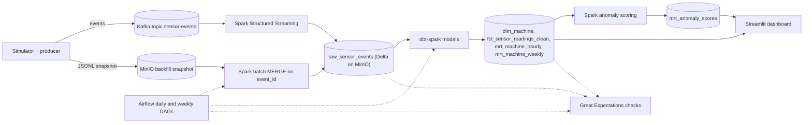

# FactoryPulse

 

IoT predictive maintenance pipeline that runs on one laptop at $0 cost. A
simulator emits sensor events. Kafka and Spark land them in a Delta lake on
MinIO. dbt models the lake, Spark scores anomalies, Great Expectations checks
the raw lake and the dbt models, Airflow schedules the batch work, and
Streamlit shows machine health. Docker Compose runs every service; nothing
touches a cloud account.

---

## Architecture



What each stage does:

| Stage | What it does | Where |
| :-- | :-- | :-- |
| Event contract | Defines the sensor event every stage produces or consumes, and validates it. | `src/factorypulse/contract.py`, `src/factorypulse/validator.py` |
| Simulator | Generates deterministic events for a fleet of machines, with injected spikes and drift. | `src/factorypulse/simulator.py` |
| Producer | Publishes the events to Kafka and writes the same events to MinIO as a JSONL snapshot. | `src/factorypulse/producer.py` |
| Streaming ingestion | Reads the topic, validates each event, and appends valid events to `raw_sensor_events`. Rejected events go to a sibling invalid table with their validation errors. | `spark/streaming_ingest.py` |
| Batch ingestion | Replays the snapshot into the same table through an idempotent MERGE on `event_id`. | `spark/batch_ingest.py` |
| dbt models | Build `dim_machine`, `fct_sensor_readings_clean`, `mrt_machine_hourly` and `mrt_machine_weekly` as Delta tables. | `dbt/models/marts/` |
| Anomaly scoring | Scores each machine's hourly temperature and vibration as a z-score against its trailing 24-hour baseline, and merges the result into `mrt_anomaly_scores`. | `spark/anomaly_detection.py`, `src/factorypulse/anomaly_core.py` |
| Quality checks | Run Great Expectations over the raw lake, the daily models and the weekly mart, and fail on any broken check. | `src/factorypulse/quality/` |
| Orchestration | `factorypulse_daily` runs batch ingestion, the raw checks, the daily dbt build and the model checks. `factorypulse_weekly` builds the weekly mart and checks it. | `dags/factorypulse_dag.py` |
| Dashboard | Shows fleet KPIs, hourly temperature and vibration trends, and the at-risk machines. | `src/factorypulse/dashboard.py` |

`docs/architecture-guide.md` describes each component in more detail.

---

## Quickstart

### Prerequisites

- Docker with Docker Compose v2.
- Bash. On Windows, use Git Bash.
- Python 3.11 or later, for the host test suite only.

### Run everything

Clone the repository, then create `.env` from the template in the repository
root:

```bash
cp .env.example .env
```

Then run the whole pipeline once with one command:

```bash
bash scripts/lake.sh all
```

It starts the platform (MinIO, Kafka, the streamer and the dashboard), produces
events, ingests them by stream and by batch, checks the raw lake, builds and
checks the dbt models, and scores anomalies. The first run builds the images
and takes several minutes. When it finishes, open the dashboard on
<http://localhost:8501>.

Stop everything with `docker compose down`. Add `-v` to also delete the lake
and the Airflow database.

### Run one stage

Each driver step runs one compose service and can be rerun on its own:

```bash
bash scripts/lake.sh produce      # publish events and write the snapshot
bash scripts/lake.sh batch        # batch-ingest the snapshot
bash scripts/quality.sh ingestion # check the raw lake
bash scripts/dbt.sh run           # build the dbt models, then check them
bash scripts/lake.sh anomaly      # score the hourly mart
bash scripts/dbt.sh fixture       # offline dbt build against fixture data
```

`bash scripts/reset-lake.sh` deletes the Delta tables and the streaming
checkpoints, so the next run starts from an empty lake.

### Schedule with Airflow

Set `FACTORYPULSE_HOST_DIR` in `.env` to the repository's path as the Docker
daemon sees it (see `.env.example`), then:

```bash
docker compose --profile airflow up -d airflow-webserver airflow-scheduler airflow-dag-processor
```

The UI is on <http://localhost:8080>. The DAGs start unpaused, so the latest
daily run starts as soon as Airflow is up. Each task runs one driver step,
such as `bash scripts/lake.sh batch`, so any task can be rerun by hand from the
repository root. Without `FACTORYPULSE_HOST_DIR` or `AIRFLOW_JWT_SECRET`, the
DAG file does not load, and the UI's import errors name the missing setting.

One job container runs per compose service at a time. A step removes a
container of its service left over by a killed task before it starts. A step
run by hand stops a scheduled job of the same service, and Airflow retries
that job. Stopping Airflow (`docker compose stop` or `down`) also removes the
job containers its tasks started, and the interrupted tasks retry on the next
start. Job containers started by hand are not touched.

---

## Configuration

Compose reads every credential from `.env`. `.env.example` lists every
variable compose reads, with development values. `.env` is ignored by git.

| Variable | Used by |
| :-- | :-- |
| `MINIO_ACCESS_KEY`, `MINIO_SECRET_KEY` | MinIO and every service that reads or writes the lake |
| `AIRFLOW_JWT_SECRET` | The Airflow processes, to sign task tokens |
| `FACTORYPULSE_HOST_DIR` | The Airflow scheduler, to run the driver steps from the repository |

Without the MinIO credentials, MinIO refuses to start and names them, and
every service that needs MinIO fails with it.

---

## Tests

The host suite needs no Docker:

```bash
python -m venv .venv
source .venv/bin/activate          # PowerShell: .venv\Scripts\Activate.ps1
pip install -e . pytest -r requirements-quality.txt -r requirements-dashboard.txt
python -m pytest
```

Tests that need Docker skip unless you opt in:

- `FACTORYPULSE_DOCKER_TESTS=1` runs the Spark anomaly job, the Airflow stop
  test and the MinIO credential check in containers.
- `FACTORYPULSE_STACK_TESTS=1` runs the idempotency test against a running
  Airflow stack.

---

## Tech-stack rationale

| Component | Technology | Why |
| :-- | :-- | :-- |
| Language | Python | One language for the simulator, Spark jobs, checks and dashboard. |
| Event stream | Apache Kafka in KRaft mode | The standard event log, run as one node with no ZooKeeper. |
| Object storage | MinIO | An S3-compatible store, so the lake uses the same S3a paths as a cloud lake at no cost. |
| Table format | Delta Lake | ACID writes and MERGE, so both ingestion paths write one table without duplicates. |
| Processing | PySpark | One engine for streaming ingestion, batch MERGE and windowed anomaly scoring. |
| Transformation | dbt with dbt-spark | Tested SQL models over the same Spark and Delta runtime that writes the raw lake. |
| Orchestration | Apache Airflow | Schedules, orders and retries the batch steps. LocalExecutor over SQLite needs no database server. |
| Data quality | Great Expectations | Named checks over the raw lake and the dbt models, reported per failed check. |
| Dashboard | Streamlit with Plotly | A Python dashboard that reads Delta tables directly, with no Spark at runtime. |
| Deployment | Docker Compose | Every service in one file, reproducible on one machine, with no cloud account. |

---

## Repository

The public repository is <https://github.com/AbderrahmenElloumi/FactoryPulse>.
It holds releases only, one squashed commit per version. Development happens
in a private repository. `.scratch/repo-release/spec.md` specifies the release
process. Issues and pull requests arrive on the public repository; see
`.github/CONTRIBUTING.md`.

The specs, tickets and reviews under `.scratch/` cite role rules of the agent
workflow. Those rules are not published.

Distributed under the MIT License. See `LICENSE`.
